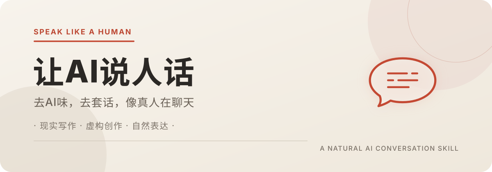

# 让AI说人话



[](https://github.com/evanyuki/human-writing/releases/latest)
[](./LICENSE)
[](https://agentskills.io/specification)

「让AI说人话」是一个中文写作 Skill。你可以拿采访笔记让它写人物稿，也可以给它一整章小说，只请它改其中一句对白。写真人，细节得有来处。写小说，人物要有自己的打算。

[更新日志](./CHANGELOG.md)

## 安装

先克隆仓库。已有工作副本可以跳过这一步。

```sh
git clone https://github.com/evanyuki/human-writing.git
cd human-writing
```

在仓库根目录，把整个 `human-writing/` 文件夹复制到 Codex 的技能目录。Windows PowerShell 用这两行。

```powershell
New-Item -ItemType Directory -Force "$HOME/.agents/skills" | Out-Null
Copy-Item -LiteralPath ./human-writing -Destination "$HOME/.agents/skills" -Recurse -Force
```

在 macOS 或 Linux 上用这两行。

```sh
mkdir -p ~/.agents/skills
cp -R human-writing ~/.agents/skills/
```

装好后，入口文件在 `~/.agents/skills/human-writing/SKILL.md`。其他支持 Agent Skills 的工具可以把这个文件夹放进各自的技能目录。

## 怎么用

在 Codex 里用 `$human-writing` 点名，把原始材料贴在要求后面。

> 用 $human-writing 把下面两周的通勤记录写成一篇折叠车评测，给跟我一样每天换乘两趟地铁的人看。保留搬车上楼那段。我没称过这辆车有多重。

现实稿缺材料时，能查的先查，只有你知道的经历才来问，一次最多三个问题。小说可以直接给人物和场景，让它往下写。用普通聊天窗口的话，把[蒸馏版](./human-writing/dist/human-writing-lite.md)和写作要求一起贴进去。

## 检查自己的稿子

把稿子存成 UTF-8 编码的 Markdown 或文本文件。假设文件叫 `draft.md`，在仓库根目录用 Python 运行下面的命令。

```sh
python human-writing/scripts/check_prose.py draft.md
```

脚本只读稿件。「需要修改」会指出命中的禁用词或句式。「需要人工判断」留给作者结合上下文决定。稿里的引语和数字还得回到原始材料核对。

## 反馈

碰到误报，可以在 [Issues](https://github.com/evanyuki/human-writing/issues) 贴出原句和脚本输出。要是觉得文章哪段写得别扭，附上那段文字和当时的写作要求就好。
